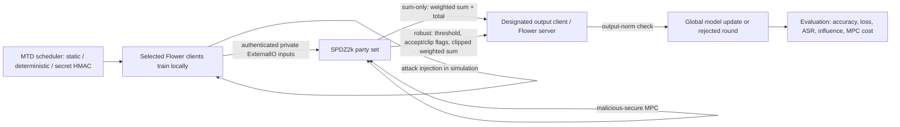

# System architecture



Two secure programs are available:

* `spdz2k_weighted_sum.mpc` (sum-only, unchanged): clients send `n·w`; the
  output client receives `Σ n·w` and `Σ n` and computes FedAvg.
* `spdz2k_robust_aggregate.mpc` (robust): clients send their update
  `Δ = w_local − w_global` at scale `2^f`; inside MPC the parties compute each
  client's squared norm, an optional adaptive threshold (lower median), screen
  and/or clip with secret coefficients, and reveal only the clipped weighted sum
  plus declared metadata. The coordinator verifies the aggregate norm before
  applying the update. Specification: `docs/secure_robust_aggregation.md`.

The secure Flower strategy selects a cohort, assigns stable logical client IDs,
creates a round ID, binds the cohort, server-known counts, weights and (robust
mode) the defence specification into each party's compiled program, and asks
all parties to run the same program (bytecode hashes must match). Failures
abort and clean up all round artefacts. Plaintext FedAvg, the plaintext robust
detector and the plaintext reference execution of the norm defence run only
when SMPC is disabled; they serve as baselines.

The party-control service uses signed requests, timestamps, unique request IDs,
persistent replay state and unique round IDs, and now reports MP-SPDZ's measured
protocol time and traffic for each completed round. Local mode provisions
SSL/client material and starts same-host services; it does not establish
independent-host isolation.

MTD changes the selected client set; it does not assign MPC parties or
guarantee client honesty. Unpredictability requires `mtd.schedule: secret` (or
the legacy `enabled: true` with `FL_MTD_SECRET` set).

## Active project layout

```text
run_experiment.py        # single Flower run (optionally with local SPDZ2k parties)
run_suite.py             # resumable evaluation grid (fl_security.experiments.grid)
analyze_suite.py         # tables, paired differences, figures
run_mpc_validation.py    # robust program vs exact reference (real SPDZ2k)
run_mpc_benchmark.py     # SPDZ2k cost across vector sizes
run_mtd_exposure.py      # schedule predictability Monte-Carlo study
src/fl_security/
  federated/   # model (CIFAR CNN, compact CNN), data (+Dirichlet), training, Flower strategy
  mtd/         # HMAC PRF, schedules, exposure/adversary models, Monte-Carlo study
  smpc/        # encoding, client I/O, party control, robust config/reference,
               # validation and benchmark harnesses, programs/*.mpc
  attacks/     # sign flip, label flip, noise, scaled replacement, backdoor, adaptive
  evaluation/  # metrics, statistics, CSV safety
  experiments/ # grid, runner, post-run analysis, reports
tests/         # unit, control-plane, Flower strategy and regression tests
```

Historical YAML conditions under `configs/` and earlier research outputs remain
in place unchanged.
