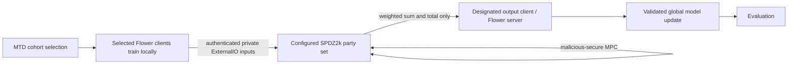

# System architecture



The party count is configuration-driven. Direct profiling and the tiny Flower integration used three parties; the README hybrid configuration requests four.

The secure Flower strategy selects a cohort, assigns stable logical client IDs, creates a round ID, binds selected IDs and server-known counts into each party's compiled program identity, and asks all parties to run the same program. Selected clients train locally and send fixed-point, sample-weighted values through MP-SPDZ ExternalIO. The circuit checks each private count against its public server-known count, sums values, and reveals the aggregate and total only to the designated output client. The strategy verifies client/proxy identity, full cohort completion, sample totals and output shape, then updates the global model. Failures abort and clean up.

There is **no contribution clipping in the current pipeline**. Robust per-client screening exists only in the plaintext branch and is rejected with sum-only SMPC. Plaintext FedAvg runs only when SMPC is explicitly disabled.

The party-control service uses signed requests, timestamps, unique request IDs, persistent replay state, and unique round IDs. The service compiles with MP-SPDZ `-M` and verifies bytecode identity across parties. Local mode provisions SSL/client material and starts same-host services; it does not establish independent-host isolation or deployment security.

MTD changes the selected client set; it does not assign MPC parties, guarantee client honesty, or prevent collusion. Secret unpredictability requires `FL_MTD_SECRET`; without it the configured experiment seed is public and deterministic. MPC-BCD and norm clipping remain feasibility research.


## Compact active project layout

```text
configs/benchmark_lr001/hybrid_verified.yaml  # documented primary MTD + SPDZ2k experiment
run_experiment.py                             # single Flower entry point
run_benchmark.py                              # optional paired-condition orchestrator
src/fl_security/
??? federated/   # model, data, training, Flower strategy, plaintext aggregation
??? mtd/         # selection, HMAC schedule, round controller
??? smpc/        # fixed-point encoding, client I/O, party control, transport, MPC circuit
??? attacks/     # simulation attack injection
??? evaluation/  # metrics, statistics, CSV safety
??? logging/     # experiment output
tests/           # unit, control-plane, Flower strategy, and regression tests
```

This is the active logical layout, not a file-move plan. Historical YAML conditions and research outputs remain in place. The MTD package, party service, client helper, transport and circuit are separate because they have different APIs and trust/lifecycle roles. Contribution clipping remains outside the active tree.
